 

 

**Desenvolvedor de Software | Backend & Full Stack**

---

## `$ whoami`

Desenvolvedor de software interessado em transformar problemas reais em soluções eficientes, bem estruturadas e escaláveis.

Meu principal foco é o **desenvolvimento Backend com Java**, trabalhando com APIs REST, Quarkus e conceitos de arquitetura de software. Também exploro o desenvolvimento Full Stack para compreender melhor todo o ciclo de construção de uma aplicação.

Valorizo código legível, boas práticas, organização e aprendizado contínuo.

## `$ tech-stack`

**01. Backend**

**02. Frontend**

**03. DevOps & Ferramentas**

## `$ featured-projects`

Projetos em que aplico meus conhecimentos para resolver problemas reais e explorar diferentes tecnologias.

<table>
<tr>
<td width="50%" valign="top">

### 🐾 MellowPet

Aplicação voltada ao bem-estar emocional, combinando inteligência artificial e interação com um pet virtual para proporcionar acolhimento e suporte emocional.

**Tecnologias**

<a href="https://github.com/GabrielMessiasdaSilva/MellowPet">Ver repositório →</a>

</td>
<td width="50%" valign="top">

### ⚙️ Poiesis

Sistema acadêmico de personalização de roupas, desenvolvido com arquitetura baseada em serviços e comunicação assíncrona entre componentes.

**Tecnologias**

<a href="https://github.com/GabrielMessiasdaSilva/poiesis">Ver repositório →</a>

</td>
</tr>
<tr>
<td width="50%" valign="top">

### 👴🏽 Safe Guardian

Sistema IoT de monitoramento e detecção de quedas em tempo real, desenvolvido para auxiliar no cuidado de idosos. Ao identificar uma possível queda, envia alertas ao cuidador por meio de um aplicativo mobile.

Apresentado em feiras tecnológicas e com artigo científico publicado.

**Tecnologias**

<a href="https://github.com/GabrielMessiasdaSilva/SafeaGuardian">Ver repositório →</a>

</td>
<td width="50%" valign="top">

### 💡 Outros projetos

Experimentos e aplicações desenvolvidos para praticar lógica de programação, explorar tecnologias e aprimorar minhas habilidades de desenvolvimento.

<a href="https://github.com/GabrielMessiasdaSilva?tab=repositories">Explorar repositórios →</a>

</td>
</tr>
</table>

## `$ github-analytics`

## `$ currently_learning`

Buscando aprofundar meus conhecimentos em:

- **Clean Code:** código legível e de fácil manutenção.
- **SOLID:** princípios para melhorar a organização do software.
- **Arquitetura de Software:** Clean Architecture e organização em camadas.
- **Modelagem:** UML e representação de sistemas.
- **Backend:** aprofundamento em Java, APIs REST e desenvolvimento de serviços.

